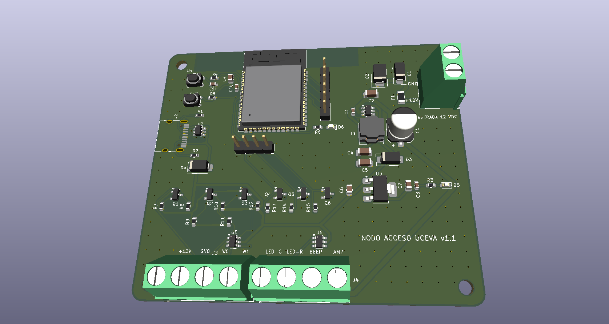

# Hardware — PCB del nodo lector (v1.1)

PCB propia del nodo de control de acceso, diseñada en **KiCad**. Integra el ESP32-S3, la alimentación desde 12 V y la interfaz con el lector Hikvision por Wiegand, lista para fabricar en JLCPCB.

## Características

- **Microcontrolador:** ESP32-S3-WROOM-1-N16R8 (16 MB flash, 8 MB PSRAM), con botones de RESET y BOOT
- **Alimentación:** entrada de 12 V por bornera con fusible PTC de 1,1 A, diodo TVS SMBJ15CA y protección contra polaridad inversa; regulador conmutado AP63205 a 5 V y LDO AP7361C a 3,3 V
- **USB-C** para programación y alimentación, con protección ESD USBLC6-2SC6; diodos Schottky que eligen solos entre los 5 V del regulador y los del USB
- **Interfaz con el lector Hikvision (Wiegand):** W0, W1 y TAMPER adaptados de 5 V a 3,3 V con transistores BSS138; salidas LED verde, LED rojo y BEEP hacia el lector; protección ESD SRV05-4 en todas las líneas del lector
- **Conectores:** borneras de 5,08 mm para 12 V, lector y control del lector; header UART0 y header de expansión con 4 GPIO libres
- LEDs de encendido y de estado
- Placa de 2 capas, 82 × 70 mm, 1,6 mm de espesor
- La versión 1.1 no incluye actuadores (relé, cerradura ni talanquera): el nodo solo registra y da la respuesta en el lector

## Archivos

| Archivo | Contenido |
| --- | --- |
| `NODO_ACCESO.kicad_pro` / `.kicad_sch` / `.kicad_pcb` | Proyecto de KiCad (esquemático y PCB) |
| `Esquematico_NODO_ACCESO.pdf` | Esquemático en PDF, para verlo sin KiCad |
| `BOM_NODO_ACCESO.csv` | Lista de materiales con referencias LCSC |
| `fabricacion/` | Gerbers, BOM y archivo de posiciones (CPL) para pedir la placa ensamblada en JLCPCB |

## Nota sobre el firmware

El [firmware](../firmware) actual corre en el prototipo armado con un ESP32 DevKit. Para esta PCB con el ESP32-S3 hay que ajustar la asignación de pines según el esquemático.
